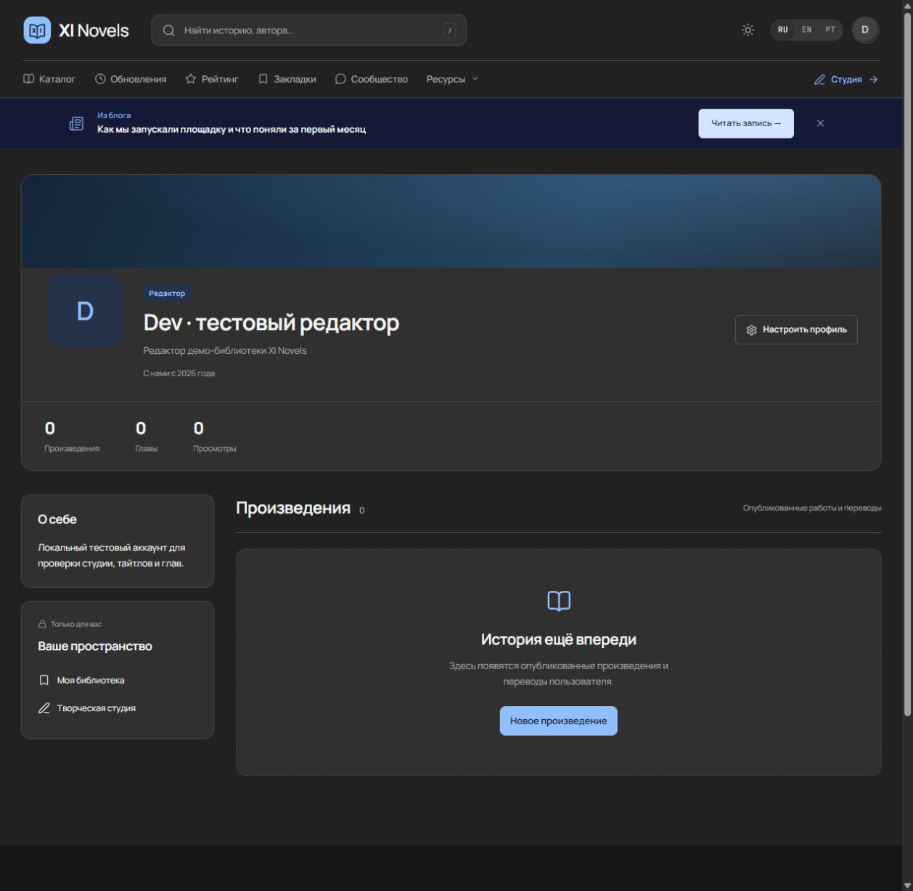
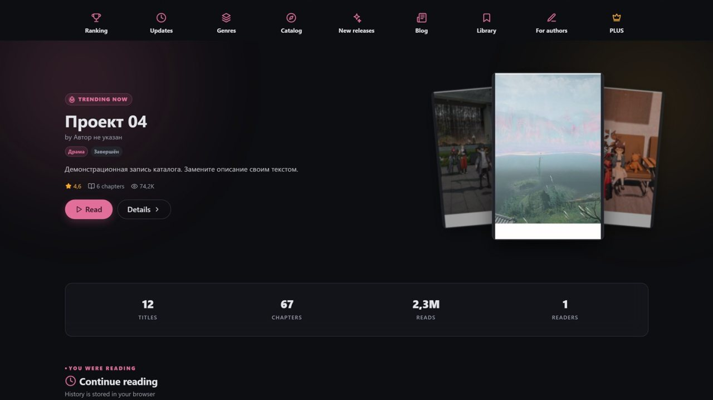
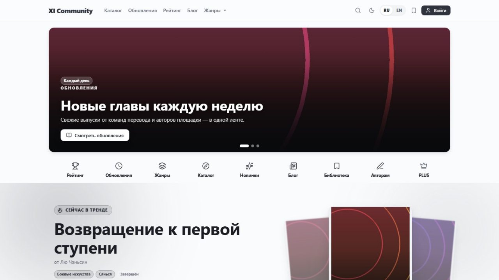
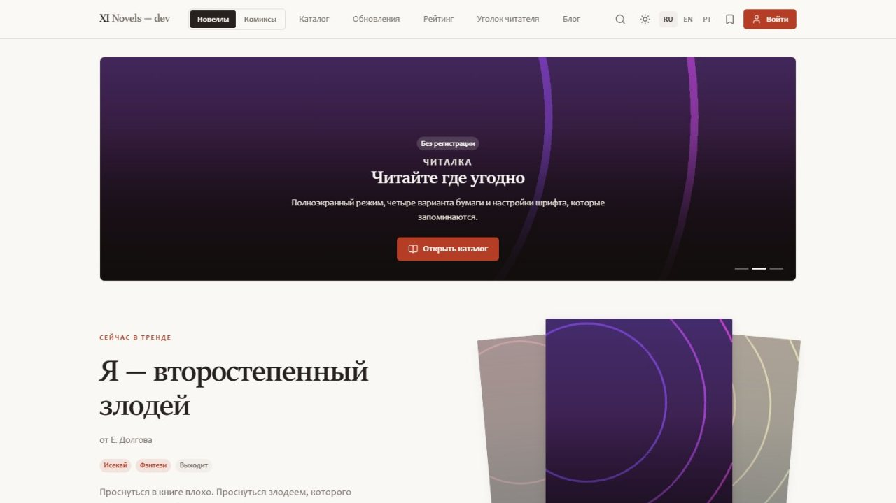
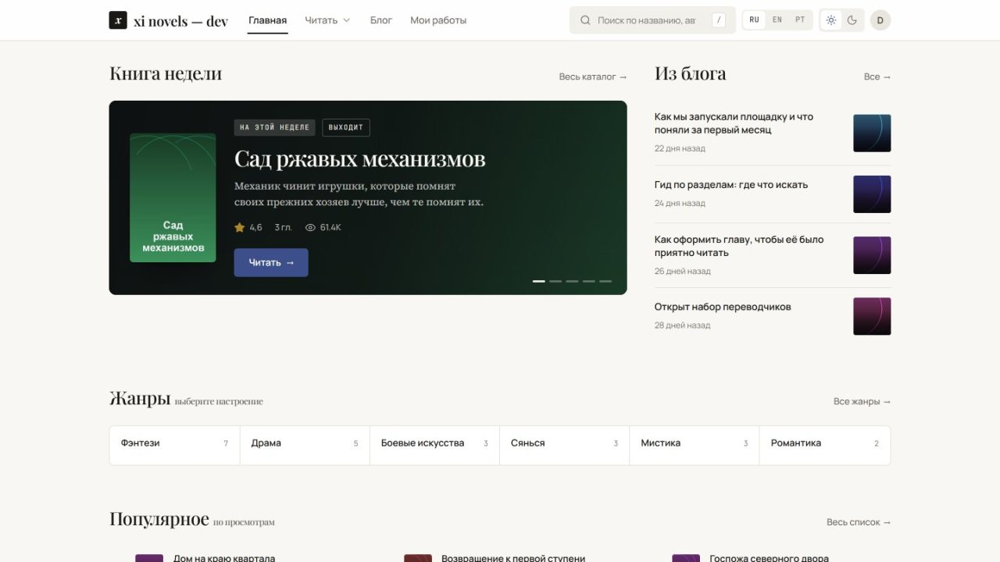
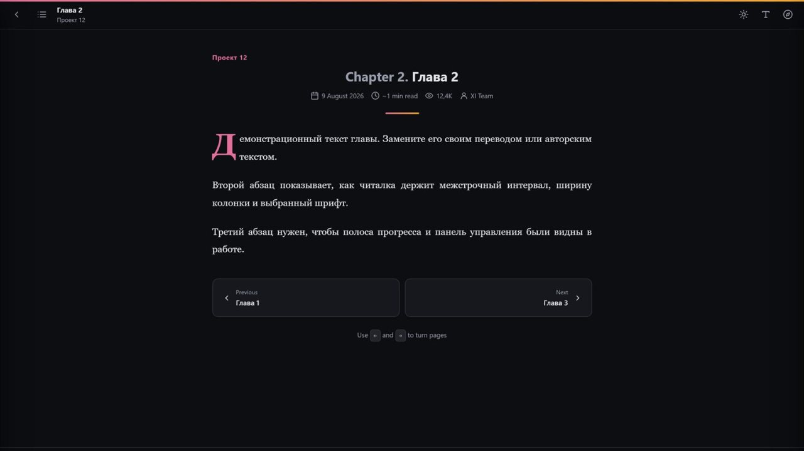
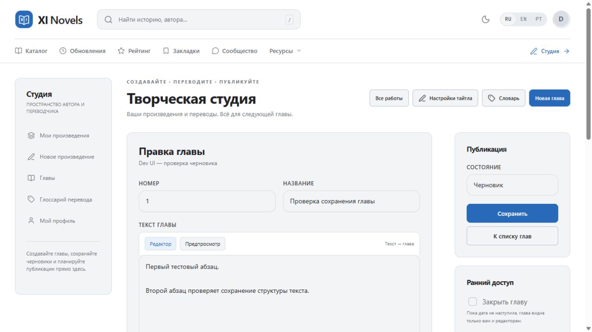

# XI Novels 3 — beta

[English](README.md) · **Русский** · [Português](README.pt-BR.md)

<picture>
  <source media="(prefers-color-scheme: dark)" srcset="screenshots/xin-v2-3/home-dark.jpg">
  
</picture>

<sub>Картинка выше повторяет вашу тему GitHub — светлую или тёмную.</sub>

XI Novels — тема WordPress для сайта новелл и переводов: витрина, каталог, страница тайтла, читалка, обсуждения и студия автора и переводчика. В третьей версии основной темой стала **XIN-V2**. Прежняя тема **XIN-Com** осталась в репозитории как альтернатива. Обе работают на одной базе.

> **Бета.** Модель данных `_xin_*`, иерархия шаблонов и хуки стабильны. Разметка общих компонентов может меняться между бетами. Перед установкой на рабочий сайт сделайте резервную копию базы и `uploads`.
>
> **Скачать:** [последний релиз](https://github.com/rurumiru/wordpress-novel-themes/releases/latest) — тема, XIN Setup и демо.

## Последний релиз: 3.0.4-beta.1 — профили участников

У каждого участника появилась публичная страница: баннер, аватар, роль, год регистрации, описание, ссылки и опубликованные работы. В работы входят собственные тайтлы и проекты, где человек числится в команде. Статистика считается по всему списку, обложки листаются по двенадцать.

На публичную страницу не попадают черновики, чужие проекты, почта и история чтения. Ссылки на личную библиотеку и студию видит только владелец. Описание, псевдоним, подзаголовок, ссылки и аватар может поменять любой вошедший участник, включая подписчиков, — в той же форме профиля на сайте.



## Путь: от первой беты до третьей версии

Первая публичная бета вышла 15 августа 2026 года, XI Novels 3 — 13 октября. За это время вышло 26 версий с тегами, а внешний вид менялся четыре раза.

<table>
<tr>
<td width="44%" valign="top">

**0.0.1-beta** · 15 августа

Первая публичная бета, тогда ещё под именем XI Novels. Тёмная схема по умолчанию и розовый акцент. Bootstrap 5.3.3 лежит в самой теме и перекрашен через HSL-токены. Главная собрана из двенадцати независимых блоков: ряд иконок разделов, «Сейчас в тренде», полоса счётчиков. Читалка открывается на весь экран, без шапки и подвала.

Уже с первого дня: ни одного внешнего запроса, студия автора вне `/wp-admin`, русский и английский.

</td>
<td width="56%"></td>
</tr>
<tr>
<td valign="top">

**0.0.8 – 0.0.9** · 16 августа

Вход, регистрация и восстановление пароля переехали на страницу сайта. Вместо малинового — белая бумага и графит. Кнопки перестали быть «пузырями», колонка сайта сузилась до 1160 px. Появилась панель управления на сайте для модераторов: пользователи, роли, очередь проверки, тайтлы и настройки.

</td>
<td></td>
</tr>
<tr>
<td colspan="2" valign="top">

**0.1 – 0.8** · 18–30 августа

Две недели ушли на функции. Выгрузка в EPUB и FB2, серии чтения и достижения, соавторы, платные главы через WooCommerce, обсуждения отдельным модулем, плагин импорта глав из .docx и Google Docs. Вместо TinyMCE — свой редактор глав: около 600 строк без npm, вставка из Word и Google Docs приходит чистой. Словарь переводчика, студия облика XI Studio с живым предпросмотром, бразильский португальский. Инструменты абзаца и чтение вслух — их прислал пул-реквестом HeavenlyCatCodes. Уголок читателя, рейтинг отдельной страницей, массовое управление тайтлами.

В 0.8.0 появился раздел комиксов. Формат комикса — поле тайтла, а не второй тип записи, поэтому каталог, рейтинг и студия остались общими. Добавилась выгрузка страниц в S3-совместимое хранилище, а тема сменила имя на XIN-Com.

</td>
</tr>
<tr>
<td valign="top">

**0.9.0** · 9 сентября

Облик собран заново, теперь он идёт от книги: тёплая бумага, чернила и один штемпельный акцент, антиква в заголовках, волосяные линии вместо теней. Ряд иконок и полоса счётчиков выключены по умолчанию, свечения и градиенты убраны.

Нагрузочная проверка: песочница на 400 тайтлов и 14 000 глав. Тайтл на 4000 глав открывается за полсекунды с холодным кэшем.

</td>
<td></td>
</tr>
<tr>
<td valign="top">

**2.0.0** · 12 сентября

Вторая тема, XIN-V2, написана с нуля под большие библиотеки и без CSS-фреймворка. В ней бесконечная прокрутка в читалке, чтение вслух, закладки и цитаты по абзацам, Web Push о новых главах и отложенная публикация. Рядом вышли плагины XIN Turbo (скорость) и XIN Setup (настройка сайта). Обе темы держат одну модель данных `_xin_*`.

</td>
<td></td>
</tr>
<tr>
<td valign="top">

**3.0** · 12–13 октября

Вышла XI Novels 3, и основной темой стала XIN-V2. Новый логотип и двухуровневая навигация, редакционная главная с иллюстрированной каруселью, каталог, где первой видна обложка, страница тайтла с личной оценкой от 1 до 5. Читалка вернулась к одной главе на страницу. Весь интерфейс набран Manrope, в обсуждениях видны роли.

В 3.0.1 — демо с иллюстрациями, в 3.0.3 — новый рейтинг и выверенные переводы на английский и бразильский португальский, по 683 записи.

</td>
<td></td>
</tr>
</table>

**Читалка: было и стало**

| 0.0.1 · август | 3.0 · октябрь |
|---|---|
|  |  |

## Фронтенд

- **Без сборки.** Нет ни npm, ни бандлера, ни CSS-фреймворка. Стили построены на собственной системе токенов. Скрипты — обычный JavaScript, разложенный по модулям: интерфейс, читалка, обсуждения, словарь, уведомления. Подключаются в конце страницы.
- **Ни одного запроса на чужой домен.** Шрифты лежат в теме: Manrope для интерфейса и ещё три семейства, только кириллица и латиница. Иконки — встроенный SVG.
- **Читалка.** Одна глава на страницу и фиксированная панель: предыдущая и следующая глава, оглавление, история, комментарии. Кегль, ширина колонки, бумага и тема запоминаются.
- **Обсуждения свои.** `comment_form()` и `wp_list_comments()` не используются: они тянут чужую разметку и перезагрузку страницы. Есть ответы, реакции и отметки ролей — читатель, редактор, автор.
- **Светлая и тёмная схемы**, переключатель RU / EN / PT. Выбор языка хранится в куке, поэтому ссылками делятся как обычно.
- **Телефон.** Шторка меню и нижняя навигация, раскладка проверена на 320, 390 и 768 px. Карусель листается стрелками, точками, клавиатурой и обычной прокруткой и учитывает `prefers-reduced-motion`. Поиск открывается клавишей <kbd>/</kbd>.
- **Web Push** о новых главах через service worker.

## Бэкенд

- **Модель данных.** Типы записей `novel` и `chapter`, таксономии жанров, меток и статусов, мета `_xin_*`. Мета общая у XIN-V2 и XIN-Com, поэтому тему можно сменить без переноса данных.
- **Порядок глав** хранится индексом в мете тайтла и пересобирается сам, когда глава появляется, меняет номер или статус либо удаляется. Оглавление тайтла на 4000 глав стоит шесть запросов — столько же, сколько у тайтла на четыре.
- **Просмотры** копятся в кэше объектов и записываются в базу одним `UPDATE` на пачку. Прибавление идёт в самой базе, поэтому два посетителя в одну секунду дают два просмотра.
- **Списки карточек** поднимают мету, термины и обложки одним заходом: каталог из 24 карточек — 9 запросов вместо 91.
- **Доступ к главе** решается в одном месте. Понимаются оба замка: ранний доступ до даты и покупка товара WooCommerce. Страница главы, оглавление, лента и выгрузка отвечают одинаково.
- **EPUB и FB2** собираются на лету и отдаются потоком. Готовые файлы не хранятся, поэтому и не устаревают после правки главы. В книгу попадает только то, что читателю и так открыто.
- **Оценки.** Повторный голос заменяет прежний, итоги, пришедшие с импортом, сохраняются. Значения вне 1–5, дробные и анонимные отклоняются.

| Плагин | Что делает |
|---|---|
| **XIN Setup 3** | После активации темы или импорта заводит страницы и меню, включает ЧПУ, проверяет маршруты и пересчитывает счётчики порциями по 100 тайтлов. Повторный запуск не создаёт дубликатов. |
| **XIN Turbo** | Кэш готовых страниц для гостей: страница тайтла отдаётся за 0,015 с вместо 0,41 с, повторный заход с ETag получает 304 и ноль байт. Вошедшим кэш не отдаётся. |
| **XIN-V2 Kit** | Держит типы записей и мету вне темы, следит за счётчиками и чинит расхождения. |
| **XI Novel Import** | Импорт глав из .docx, .txt, .md, .html, ZIP и Google Docs по ссылке; очередь по расписанию. |
| **XI From Fictioneer** | Перенос сайта с темы Fictioneer — порциями, с журналом и откатом. |
| **XI Novel Manager** | Массовая правка тайтлов: статусы, жанры, владельцы, обложки, CSV. |

## Почему всё вне админки

WordPress рассчитан на то, что работа идёт в `/wp-admin`. На сайте для чтения это неудобно почти всем, кто на нём работает, поэтому у читателя, автора и модератора есть свой экран на самом сайте. Права, данные и проверки при этом остаются за WordPress.

- **Читатель.** `wp-login.php` выглядит как чужая страница, причём ровно там, где человек впервые доверяет площадке почту и пароль. Поэтому вход, регистрация и восстановление пароля живут на обычной странице сайта в его оформлении. Имя и пароль проверяет ядро (`wp_signon()`, `register_new_user()`), своей криптографии в теме нет. После восьми неудачных попыток с одного адреса форма закрывается на 15 минут. Панель инструментов WordPress на страницах сайта скрыта.
- **Автор и переводчик.** Тому, кто выкладывает главы, нужен инструмент для текста, а не CMS. Студия на сайте: тайтлы, главы, черновики, расписание, ранний доступ, команда проекта, словарь и профиль. Отдельной роли нет — используется штатная роль WordPress «Автор». Соавторы правят тайтлы, в команде которых состоят.
- **Модератор.** Модератору нужны три вещи: очередь комментариев, роли и заявки в авторы. Гонять его ради них по таблицам админки незачем: там он увидит и всё остальное, что ему видеть не нужно. Панель на сайте даёт ровно эти три вещи. Администратора оттуда не повысить и не понизить, свою роль поменять нельзя.
- **Что остаётся за WordPress.** Каждое действие на сайте проходит проверку nonce и `current_user_can()`. Данные — обычные записи, мета и таблица комментариев. Поэтому работают модерация, антиспам, импорт и резервные копии, а `/wp-admin` по-прежнему открыт администратору для всего остального.

## Установка

Нужны WordPress 6.4+ и PHP 8.0+. Для текста, обложек и EPUB нужны `mbstring`, поддержка изображений и `ZipArchive`.

1. Установите тему из `xin-v2-3.0.4-beta.1.zip` и активируйте **XI Community Library**.
2. Установите плагин из `xin-setup-3.0.0.zip` и активируйте **XIN Setup**.
3. Откройте консоль WordPress: настройка запустится сама. Отчёт — в **Инструменты → Настройка темы**.
4. Импортируйте свои тайтлы или поставьте `xi-demo-content-3.0.1.zip`, чтобы посмотреть тему на демо.

> **Сервер.** Apache нужен доступный на запись `.htaccess`. На Nginx — обычный для WordPress `try_files $uri $uri/ /index.php?$args;`: конфигурацию Nginx плагин поменять не может.

| Файл | Что это |
|---|---|
| `xin-v2-3.0.4-beta.1.zip` | Тема. В списке тем называется **XI Community Library**. |
| `xin-setup-3.0.0.zip` | XIN Setup 3 — автоматическая настройка сайта. |
| `xi-demo-content-3.0.1.zip` | Демо: 15 тайтлов, 65 глав, три иллюстрированные обложки. Необязательно. |

Остальные плагины лежат в папке `plugins/` репозитория.

## Что проверено и чего пока нет

Проверено на локальной установке: PHP 8.3, WordPress, база SQLite. Настройка, рейтинг, студия, обсуждения, библиотека, выгрузка EPUB и FB2, переключение языка и схемы, раскладка на 320, 390 и 768 px. На физических iOS и Android тема не проверялась. Доставку почты и Web Push, оплату через WooCommerce и сочетания со сторонними плагинами нужно проверять в своём окружении.

## Состав репозитория

| Путь | Что там |
|---|---|
| `themes/xin-v2` | Основная тема 3.0 |
| `themes/xin-com` | Альтернативная тема на той же базе |
| `plugins/xin-setup` | Автоматическая настройка после установки и импорта |
| `plugins/xi-novel-import`, `plugins/xi-from-fictioneer` | Импорт |
| `plugins/xi-novel-manager`, `plugins/xi-studio` | Массовое управление тайтлами и студия облика |
| `plugins/xin-turbo`, `plugins/xin-v2-kit` | Скорость и обслуживание данных, по желанию |
| `screenshots/xin-v2-3` | Скриншоты текущего дизайна |
| `docs/media/history` | Скриншоты прошлых версий |
| `docs/media/covers` | Демо-обложки |
| `tools/verify-release.php` | Локальные проверки настройки и рейтинга |

В репозитории нет базы WordPress, `uploads`, учётных записей и паролей. Тексты и счётчики на скриншотах — демо-наполнение.

## Проверка своими руками

```bash
php tools/verify-release.php /path/to/test-wordpress/wp-load.php
```

Скрипт меняет настройки сайта и создаёт временные записи, которые потом уходят в корзину. Запускайте его только на тестовой установке.

Лицензия — GPL-2.0-or-later, см. [LICENSE](LICENSE).

[Журнал изменений](CHANGELOG.md) · [Презентация дизайна](docs/design-v3.md) · [Установка](docs/install.ru.md) · [Отчёт о проверке](docs/validation-v3.md)

## Как это выглядит

<table>
<tr>
<td width="33%"><br><sub>Каталог</sub></td>
<td width="33%"><br><sub>Тайтл</sub></td>
<td width="33%"><br><sub>Карусель</sub></td>
</tr>
<tr>
<td><br><sub>Читалка</sub></td>
<td><br><sub>Студия</sub></td>
<td><br><sub>Обсуждения</sub></td>
</tr>
</table>

<table>
<tr>
<td width="25%"></td>
<td width="25%"></td>
<td width="25%"></td>
<td width="25%"></td>
</tr>
</table>

<sub>Телефон, 390 px; рейтинг — на бразильском португальском.</sub>
