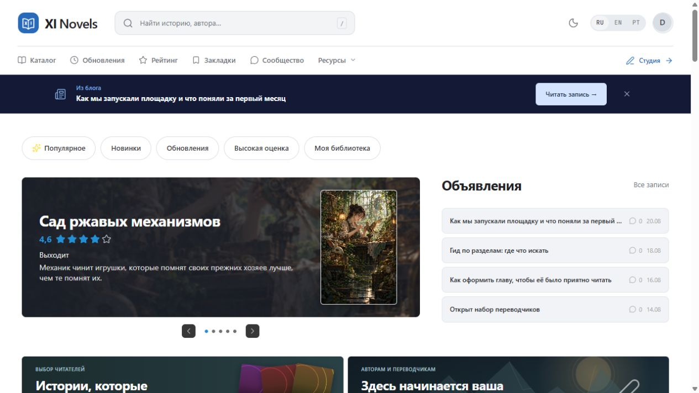
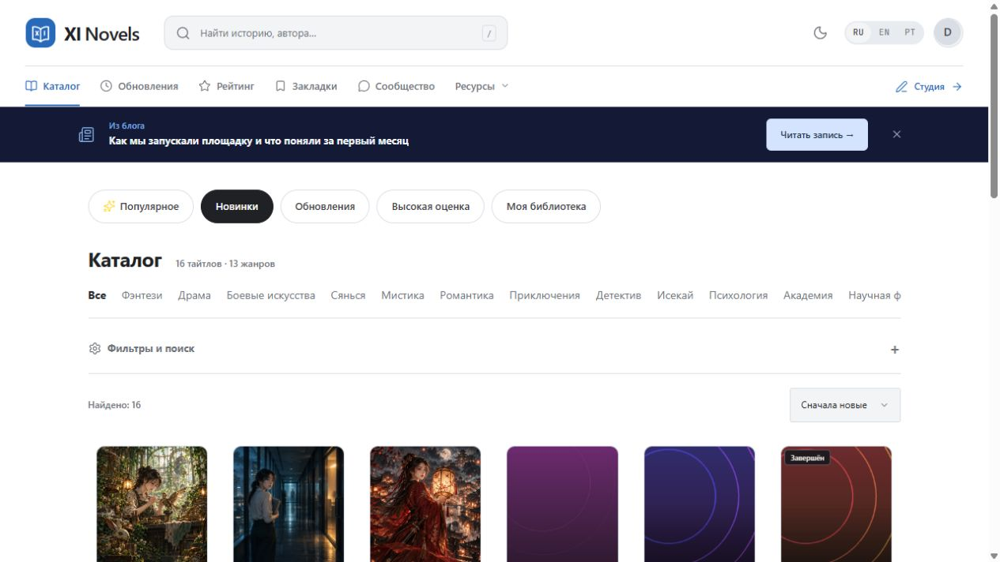
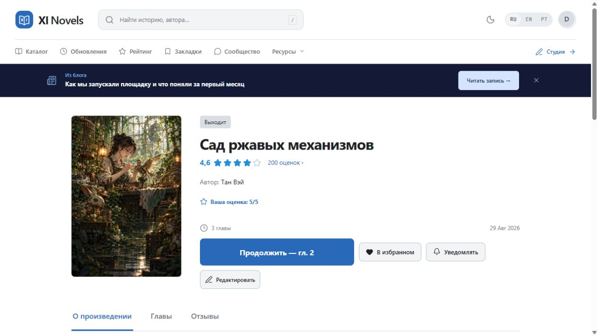
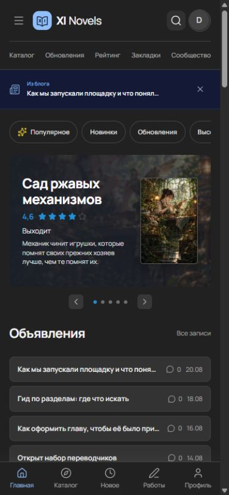
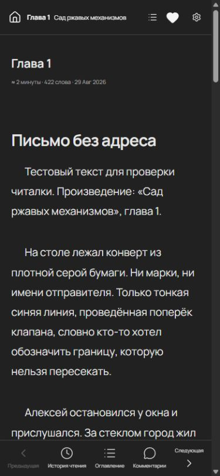

# XI Novels 3

**XIN-V2 — основная тема WordPress:** новая витрина новелл, каталог, читалка по одной главе и фронтенд-студия авторов и переводчиков.

[English](README.md) · [Português](README.pt-BR.md) · [Презентация дизайна](docs/design-v3.md) · [Установка](docs/install.ru.md)



## Что изменилось

- Новое лого XI Novels и навигация: поиск, профиль, разделы, ресурсы и студия.
- Главная с редакционной подборкой, рейтингом, иллюстрированной каруселью, жанрами, историей чтения и обновлениями.
- Каталог с обложками, поиском, фильтрами и сортировкой.
- Страница тайтла с данными об авторе, статистикой, оценками 1–5, закладками, главами, отзывами и экспортом EPUB/FB2.
- Читалка открывает **одну главу на странице**. Настройки текста, ширины и оформления сохраняются между переходами.
- Шрифт Manrope, новые карточки обсуждений, значки ролей, ответы и реакции.
- Мобильное меню и нижняя навигация, светлая/тёмная тема, русский, английский и португальский интерфейс.
- Студия для управления тайтлами, главами, расписанием, командой и глоссарием с проверкой прав WordPress.

Референсы структуры — Wuxiaworld, KakaoPage и Novelpia. Код, лого и тестовые иллюстрации созданы для проекта. Подробности и все экраны — в [презентации](docs/design-v3.md).

| Каталог | Тайтл |
|---|---|
|  |  |

| Мобильная главная | Читалка |
|---|---|
|  |  |

## Быстрая установка

WordPress 6.4+, PHP 8.0+. Для соответствующих функций нужны `mbstring`, обработка изображений и `ZipArchive` (EPUB). Сборка фронтенда не требуется, шрифты и ресурсы локальные.

1. Скопируйте `themes/xin-v2` в `wp-content/themes` и активируйте **XI Community Library**.
2. Скопируйте `plugins/xin-setup` в `wp-content/plugins` и активируйте **XIN Setup**.
3. После активации или импорта откройте админку. Модуль настроит страницы и шаблоны, меню, ЧПУ, жанры и счётчики. Отчёт: **Инструменты → Настройка темы**.
4. Импортируйте книги, главы и обложки, проверьте каталог и чтение.

[Подробная установка](docs/install.ru.md) · [Модуль автонастройки](plugins/xin-setup/README.md) · [Импорт](docs/import.ru.md)

На Apache нужен доступный для записи `.htaccess`. На Nginx настройте WordPress fallback в конфигурации сервера; плагин не может менять Nginx. Существующие тексты страниц и назначенные меню сохраняются.

## Состав репозитория

Основная тема: `themes/xin-v2`. Альтернативная `themes/xin-com` сохранена. В `plugins` находятся модуль настройки, импортёры и дополнительные инструменты. Новые скриншоты — `screenshots/xin-v2-3`, тестовые обложки и промпты — `docs/media/covers`.

В репозитории нет локальной базы, `uploads`, тестовых паролей и учётных записей. Счётчики и тексты на скриншотах относятся к демонстрационному наполнению.

[Отчёт локальной проверки](docs/validation-v3.md) описывает проверенные сценарии и ограничения. Для повторения автоматических проверок на тестовой установке:

```bash
php tools/verify-release.php /path/to/test-wordpress/wp-load.php
```

Скрипт меняет настройки тестового сайта и создаёт временные записи с последующим перемещением в корзину. Не запускайте его на рабочей базе без подготовки.

Лицензия GPL-2.0-or-later: [LICENSE](LICENSE).
