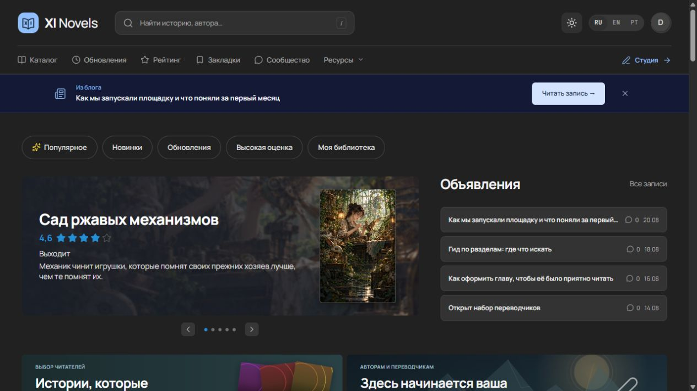
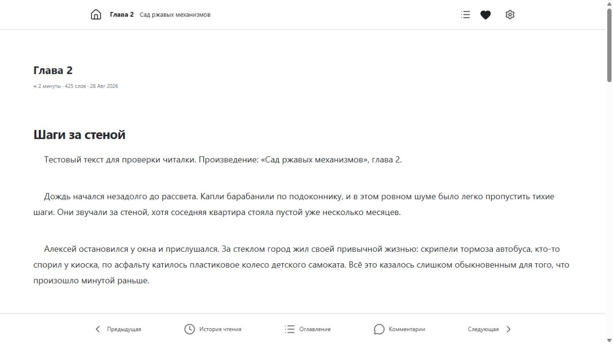
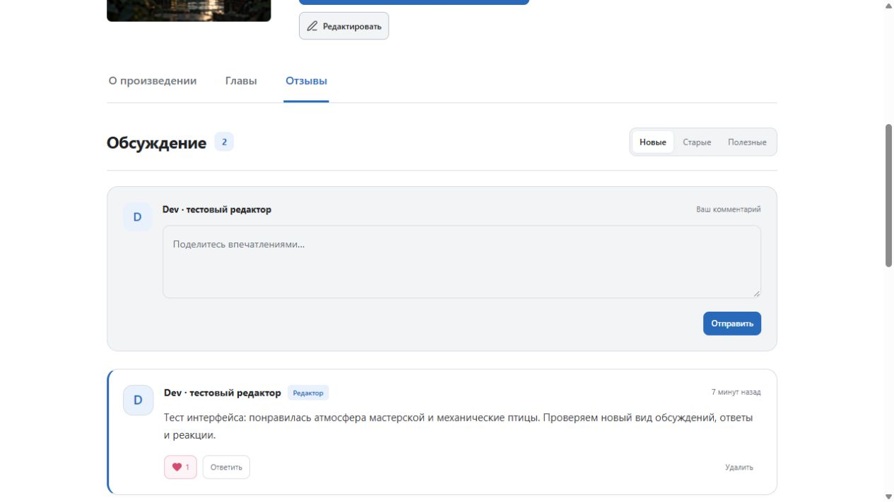
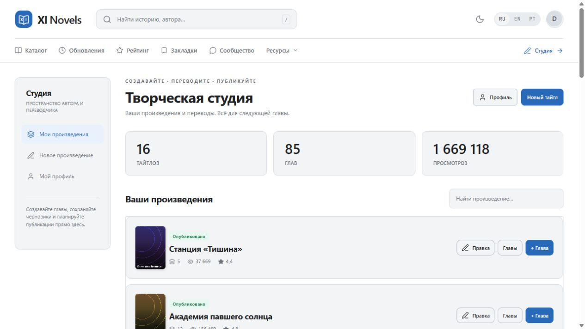
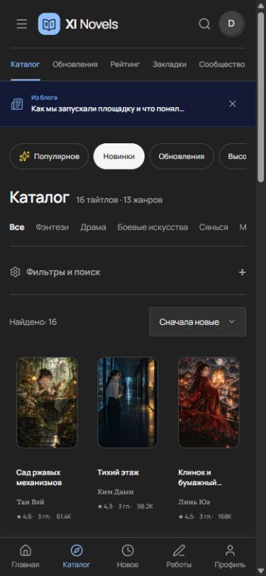
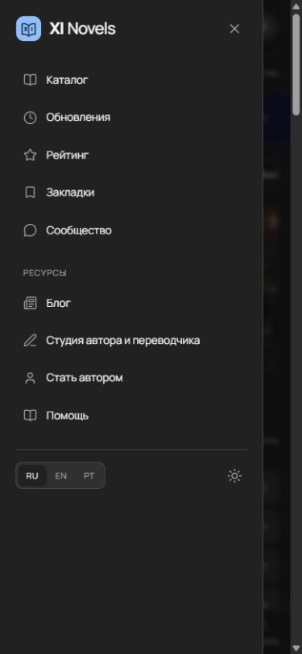
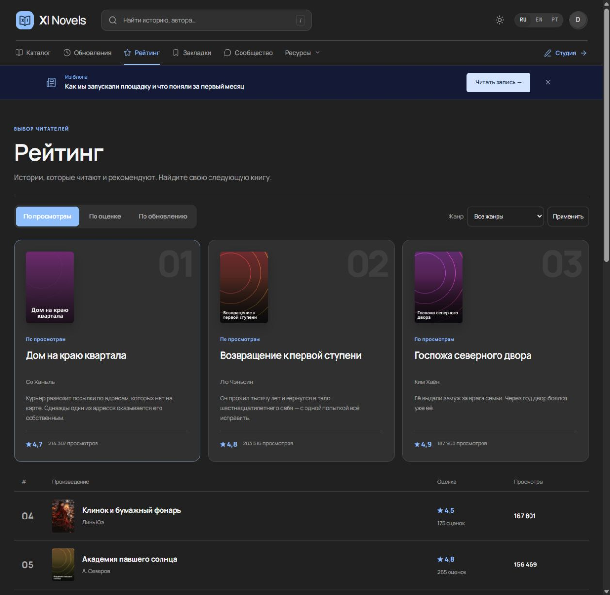
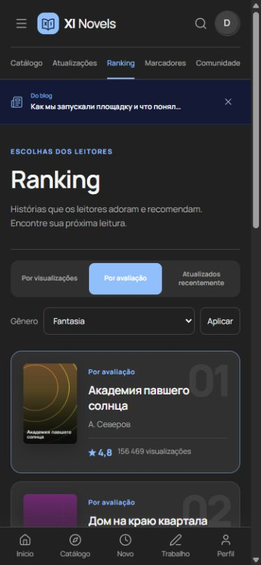

# XI Novels 3 — presentation

[English overview](../README.md) · [Русский](../README.ru.md) · [Português](../README.pt-BR.md)

**XIN-V2 is the primary design.** It combines an editorial novel portal, a cover-first discovery catalog, and a focused single-chapter reader. Wuxiaworld, KakaoPage and Novelpia were layout references; the implementation, logo and generated demo illustrations belong to this project. Their brand assets are not bundled.

## Home and navigation

Two-level navigation separates search and account controls from catalog sections. A compact mobile drawer provides the same routes, languages and theme switch. The homepage uses actual WordPress titles, chapters, genres and ratings: featured stories, announcements, reading rankings, illustrated discovery carousel, continue-reading shelf, popular/new titles, genre picks and recent updates.

The illustrated carousel supports arrows, dots, keyboard navigation and native horizontal scrolling. It respects reduced-motion preferences.

## Catalog and title

Genre navigation, collapsible filters, title search and sorting sit above consistent cover cards. Title pages combine cover, credits, rating, read/bookmark actions, statistics, description, chapters, reviews and download links.

Signed-in readers can rate a title from 1 to 5. Changing a vote replaces it; imported aggregate ratings are preserved.

## Reading and discussion

One chapter is loaded per page. A fixed reading bar provides previous/next chapters, contents, history and comments. Text size, column width, paper mode and theme remain adjustable.

Manrope unifies the interface typography. Discussion cards highlight names, avatars and reader/editor/author roles, with replies, reactions and moderation controls.

## Author and translator studio

The frontend studio manages titles and chapters using WordPress permissions. Editors can manage all works; authors and team members receive the access allowed by their role and project membership.

## Mobile

Screenshots below are real browser renders at a 390-pixel viewport. Responsive checks also cover 320 and 768 pixels; horizontal book shelves scroll within their containers.

| Home | Catalog | Reading |
|---|---|---|
|  |  |  |

## Installation and validation

[XIN Setup 3](../plugins/xin-setup/README.md) configures pages, menus, permalinks, taxonomies and counters after activation/import. See [installation](install.md) and the [local validation report](validation-v3.md).

Screenshots use a local demo database. Sample story text, imported rating/view counts and generated covers are demonstration content, not production activity. [Cover prompts and provenance](media/covers/PROMPTS.md).
# Ranking redesign — 3.0.3

The ranking page now has three highlighted leaders, a numbered list with vote counts and views, three sorting modes and a genre filter. Mobile cards use a compact layout.

