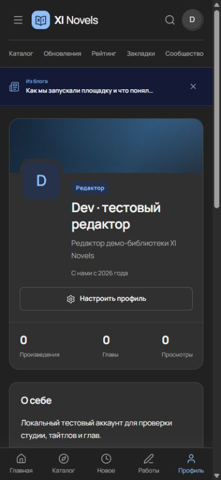

# Member profiles — beta

The public author route now shows a member banner, avatar, role, registration year, profile bio, external links and published works. Works include titles owned by the member and published projects where they are listed as a team member. Statistics use the complete published project list; covers are paginated in groups of twelve.

Drafts, unrelated projects, email addresses and library history are excluded from the public page. Links to the personal library and studio appear only for the profile owner. Every signed-in member, including subscribers, can edit their own bio, pen name, tagline, links and avatar through the existing frontend profile form.

Validation: saved the local test editor's tagline and bio through the browser, verified the public rendering, checked 320/390-pixel layouts and PT-BR labels, and checked own/team/draft/unrelated fixtures and guest versus owner controls. Fixtures were moved to trash after verification.

This remains beta software. It ships in the [3.0.4-beta.1](https://github.com/rurumiru/wordpress-novel-themes/releases/tag/v3.0.4-beta.1) release.
